<!-- BANNER DO TOPO (substitua pelo link do seu GIF ou imagem) -->

  

  

<!-- About me -->

  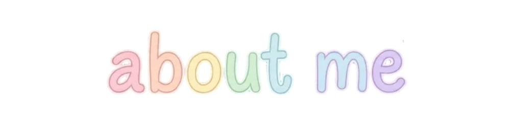

  

  

<!-- Languages -->

  

  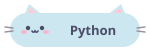
  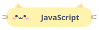
  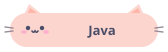
  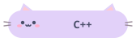
  
  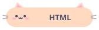

  

<!-- Technologies -->

  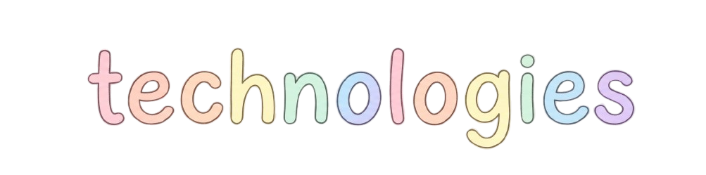

  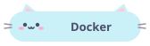
  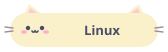
  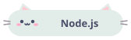
  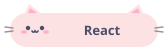
  

  

<!-- Projects -->

### Projects

 

  

